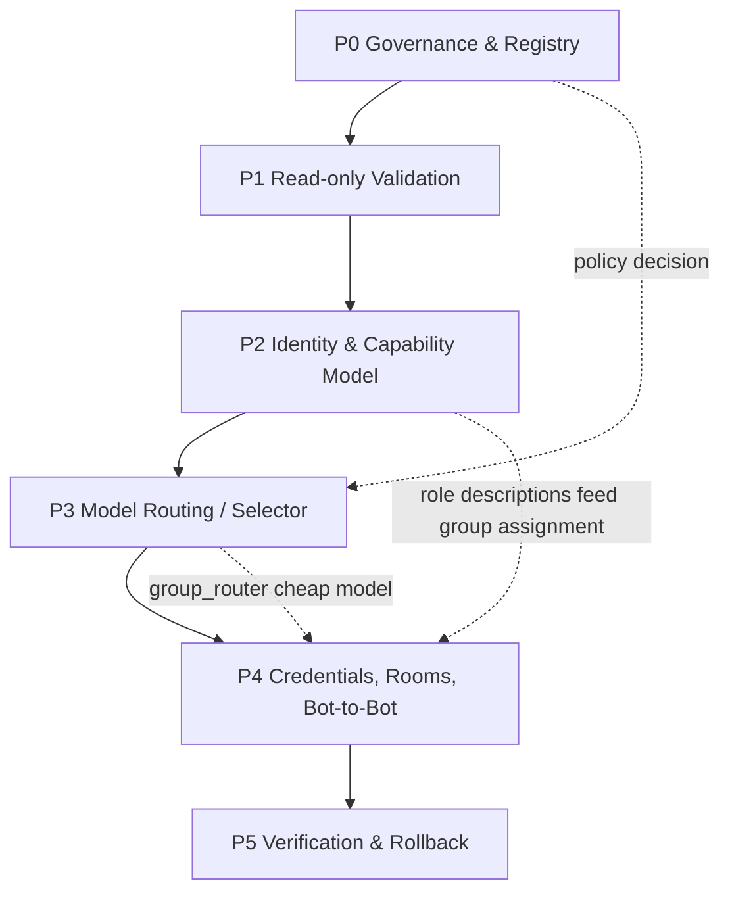

# 04 — SEQUENTIAL PLAN

> Phase sequence, testing checkpoints. **Critical element: Dependencies — build backend data models before frontends.**

---

## 1. Sequencing principle

> **Backend data models first, UX/rooms last.** The registry, profile metadata, SOULs, memory files, credential map and auxiliary-slot configuration are the "data models" of this program. Group rooms and the selector-driven experience are the "frontends" that consume them. Creating rooms before roles/config exist would produce bots with no guardrails, no correct membership metadata, and no cheap router — so they are strictly last.

```
P0 Governance & registry (data model: roster)
   ↓
P1 Read-only validation (verify data model against disk)
   ↓
P2 SOUL + MEMORY/USER + profile.yaml + tool/skill model (data model: identity & capabilities)
   ↓
P3 Model pins → selector-only + aux slots (data model: model routing)
   ↓
P4 Credentials + group rooms + bot-to-bot (consumers of P0–P3)
   ↓
P5 Verification, evidence, rollback authority
```

**Hard gates:** a phase cannot start until its predecessor's T-checklists PASS **and** its authorization row in `01-CONTEXT.md` §8 is marked "authorized".

---

## 2. Phase dependency graph



---

## 3. Authorization register (mirror)

| Phase | Authorized? | Gate to enter |
|---|---|---|
| P0 | pending | Owner signs registry + policy decision |
| P1 | pending | P0 signed |
| P2 | pending | P1 T-01 PASS |
| P3 | pending | P2 T-02/T-03/T-04 PASS |
| P4 | pending | P3 T-05/T-06 PASS |
| P5 | pending | P4 T-07/T-08/T-09 PASS |

---

## 4. Phase details

### P0 — Governance & authoritative registry

**Goal:** decide what exists and what the rules are. No writes to `~/.hermes/`.

**Actions:**
1. Re-run inventory discovery; produce `registry.md` in this SoT folder with all 34 profiles and attributes.
2. Record disposition of `researcher` (configure or retire), `splash-7777`, `local-ai-guardian.backup…`.
3. Ratify or replace `LOCAL_MODEL_POLICY.md` — specifically approve selector-only main model (ADR-2) and aux-to-2.6B (ADR-3).
4. Fill `01-CONTEXT.md` §8 P0 authorization row.

**Checkpoint:** T-01 (all boxes PASS).

**Rollback:** none needed (read-only + document edits in SoT folder).

---

### P1 — Read-only validation

**Goal:** confirm the data model against disk without mutating anything.

**Commands (read-only):**
```
hermes config get model --json
hermes config check
hermes profile list
hermes cron list
grep -R '^model:' ~/.hermes/profiles/*/config.yaml
```

**Actions:**
1. Capture effective model config, roster, routine inventory.
2. Confirm canonical Bot Chat presence per bot (list sessions, no creation yet).
3. Attach outputs as evidence to P1.

**Checkpoint:** T-01 re-verified; no writes executed.

**Rollback:** none needed.

---

### P2 — Identity & capability data model (write authorized)

**Goal:** make every bot's role and minimum config real.

**Actions:**
1. Snapshot all `SOUL.md`, `profile.yaml`, `memories/` to dated directory **outside** `~/.hermes/`.
2. Rewrite SOULs from `souls/` descriptors (FR-2); preserve asset-manager; remove generic persona.
3. Create/fix `profile.yaml` for all 34, including `ui_meta` marker (FR-3).
4. Create `memories/MEMORY.md` and `memories/USER.md` for every bot; replace orchestrator stub.
5. Add explicit tool allowlists and role-specific skill subsets; dedupe (FR-4).
6. Apply SOUL/memory changes to long-running sessions with `hermes sessions refresh-prompts` where appropriate.

**Checkpoint:** T-02, T-03, T-04 PASS.

**Rollback:** restore snapshot from step 1; refresh prompts again.

---

### P3 — Model routing / selector-only (write authorized)

**Goal:** remove pins, set global default natively, pin aux slots.

**Actions:**
1. Snapshot all `config.yaml` files.
2. Remove/unset `model.default` and `model.provider` from the 10 profile configs.
3. Set global default via `hermes model` / dashboard to intended default (recommend validated 9B local, per P0 decision).
4. Pin auxiliary slots to `LiquidAI--LFM2.5-2.6B-MLX-4bit` @ omlx across profiles (including dev-coder 35B → 2.6B); set `auxiliary.group_router` cheap.
5. Amend `LOCAL_MODEL_POLICY.md` to v2 selector-only with P0 date.
6. Verify selector choice persists after app reopen in one canary bot (dev-coder or researcher-bot).

**Checkpoint:** T-05, T-06 PASS.

**Rollback:** restore config snapshots; restart gateway/CLI to re-read.

---

### P4 — Credentials, rooms & bot-to-bot (consumers of P0–P3)

**Goal:** consolidate secrets, stand up four rooms, verify messaging.

**Actions:**
1. Name-only credential inventory; move duplicated shared keys to root `.env`; convert profile configs to `key_env`/`${VAR}` (FR-7). Never print values.
2. Verify canonical Bot Chats for all room members: `hermes -p <bot> chat -c "Bot Chat" --create-if-missing`.
3. Create four rooms with exact member sets from Architecture §5; set room assignment mode and `group_router`.
4. Test @mention scoping, 3-round/10-message caps, pause/continue, `Group: <room>` session persistence, membership persistence.
5. Test message_agent handoff: ack fields, completion outcome, retry-once on `provider_rate_limit`, zero retry on `provider_auth_or_access`, max_hops 4, duplicate refusal.

**Checkpoint:** T-07, T-08, T-09 PASS.

**Rollback:** restore `.env`/config snapshots; disband rooms via UI; deliveries are runtime — no durable config to roll back beyond room metadata.

---

### P5 — Verification, evidence & rollback authority

**Goal:** prove the program and establish rollback.

**Actions:**
1. Run `hermes config check`, `hermes doctor`, `hermes config get model --json`, `hermes profile list`, `hermes cron list`.
2. Re-run all binary checklists T-01…T-09 and attach command outputs.
3. Produce `VERIFICATION.md` in this SoT folder with PASS/FAIL per item and evidence links.
4. Record rollback snapshots manifest and criteria.

**Checkpoint:** T-10 PASS; zero FAIL across T-01…T-09.

**Rollback:** per-phase snapshot manifest; owner-authorized restore.

---

## 5. Testing checkpoints summary

| Test | Phase | Requirement |
|---|---|---|
| T-01 | P0/P1 | FR-1 registry truth |
| T-02 | P2 | FR-2 SOUL alignment |
| T-03 | P2 | FR-3 minimum config |
| T-04 | P2 | FR-4 capability curation |
| T-05 | P3 | FR-5 selector-only |
| T-06 | P3 | FR-6 cost/quality |
| T-07 | P4 | FR-7 credential hygiene |
| T-08 | P4 | FR-8 group rooms |
| T-09 | P4 | FR-9 bot-to-bot |
| T-10 | P5 | FR-10 evidence & rollback |

---

## 6. Traceability matrix (findings → risks → FR → phase → test)

| Finding | Risk | FR | Phase | Test |
|---|---|---|---|---|
| 34 vs 32 profiles; ghost `researcher`; missing estate bot | R1 | FR-1 | P0/P1 | T-01 |
| Cloud-first drift from local policy | R2 | FR-5, FR-6 | P3 | T-05, T-06 |
| Model pins override selector | R3 | FR-5 | P3 | T-05 |
| Generic SOULs; unused role descriptors; no guardrails | R4 | FR-2, FR-3 | P2 | T-02, T-03 |
| Duplicated plaintext keys in 8 `.env` | R5 | FR-7 | P4 | T-07 |
| 2,251-skill backup; global 2,273; dupes | R6 | FR-4 | P2 | T-04 |
| Broad default toolsets; one explicit allowlist | R7 | FR-3, FR-4 | P2 | T-03, T-04 |
| No USER.md; 38-byte MEMORY.md | R8 | FR-3 | P2 | T-03 |
| Routines unverified | R9 | FR-1, FR-10 | P1/P5 | T-01, T-10 |
| Archived plugin assumptions; stale backup | R10 | FR-1 | P0 | T-01 |
| Department collaboration requirement | — | FR-8 | P4 | T-08 |
| Bot-to-bot reliability requirement | — | FR-9 | P4 | T-09 |

---

## 7. Stop conditions

Stop the current phase and escalate if:
- A binary test FAILs with no safe remediation inside the phase.
- Any action would touch a Non-Goal (Context §7).
- A secret value would be exposed in a report, prompt or log.
- A profile would be deleted without Owner approval.
- Group-room caps or loop guards behave contrary to documented hard limits.
- A model switch causes uncached re-read cost that distorts verification — defer to early-session test.

---

## 8. Definition of done

- All ten FRs have PASS on their binary checklists with attached evidence.
- `VERIFICATION.md` exists with zero FAILs.
- Each phase's snapshot manifest can restore the pre-phase state.
- No changes outside the authorized scope and SoT folder are present.
